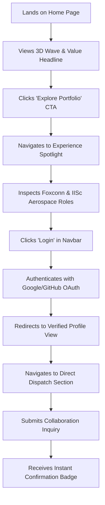
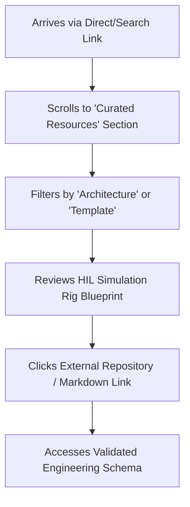
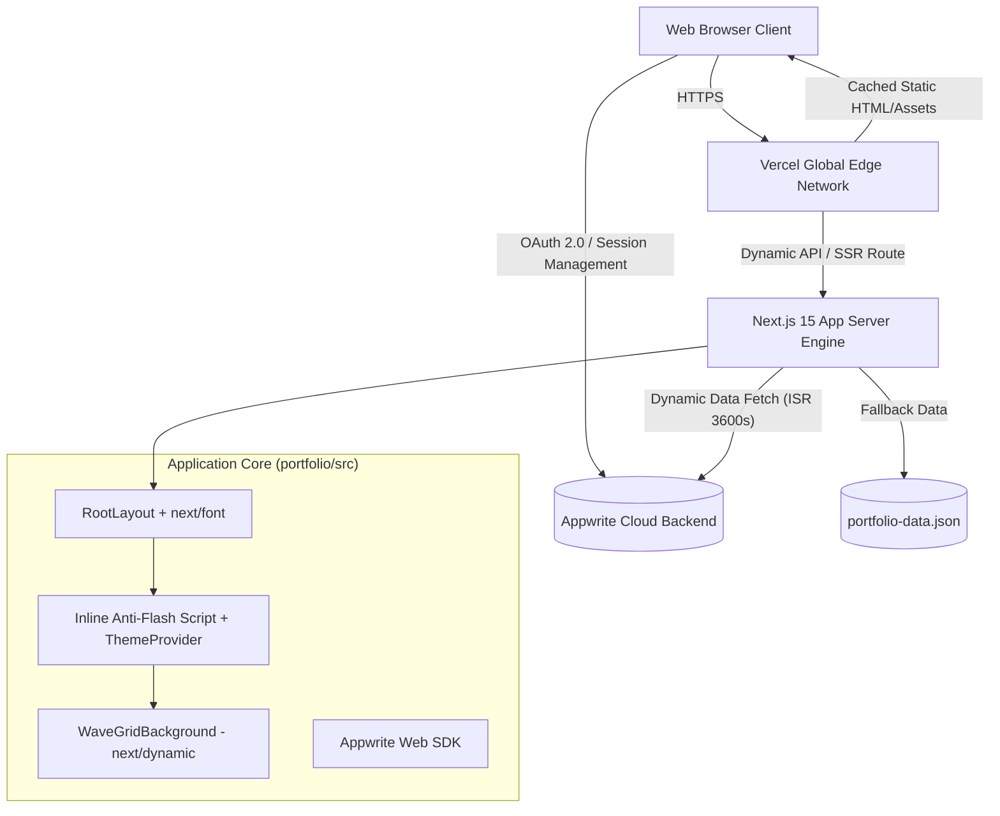

# Product Requirements Document (PRD)

## Project: AeroSys Engineering Hub & Professional Telemetry Portal
**Version:** 1.0.0  
**Document Owner:** Vikas N Dhavande (Lead Product & Avionics Systems Engineer)  
**Status:** Approved for Implementation  
**Last Updated:** October 2026  

---

## 1. Overview

### 1.1 Product Name, Version & Document Owner
* **Product Name:** AeroSys Engineering Hub (*Vikas N Dhavande Professional Platform*)
* **Version:** 1.0.0 (MVP)
* **Document Owner:** Vikas N Dhavande (Product Engineer | Embedded Systems & Avionics Specialist)
* **Technical Stack:** Next.js 15 (App Router, ISR, Server Components), TypeScript 5.8, Tailwind CSS v4, Three.js (WebGL GLSL), Appwrite Cloud Auth & Databases, Vercel Edge Network.

### 1.2 Background & Problem Statement
In deep-tech hardware domains—such as aerospace avionics, automotive electronics (ECUs/BCUs), and defense electronics—evaluating engineering talent through traditional static PDF resumes is fundamentally broken. Static resumes fail to convey:
1. **Engineering Rigor & Verification Depth:** Real-world Hardware-in-the-Loop (HIL) automated test validation, signal integrity, and root-cause analysis (RCA) cannot be verified from a 2-page document.
2. **Scarcity of Production-Grade Hardware Resources:** Practicing embedded engineers, students, and research labs struggle to find validated, open-source HIL scripts, IPC-A-610 test checklists, and Altium/KiCad hardware templates tested against actual hardware.
3. **Credibility & Security Imbalance:** High-stakes aerospace and defense projects involve sensitive intellectual property, preventing engineers from sharing raw proprietary code while simultaneously demanding proof of technical capability.

### 1.3 Product Vision & Goals
* **Vision:** Create the premier interactive hardware engineering verification platform—bridging high-stakes professional talent discovery with an open-source, community-driven repository of aerospace and avionics simulation assets.
* **Core Value Proposition:** Deliver a sub-second, 3D interactive engineering experience that proves mission-critical hardware competencies to tier-1 defense/aerospace decision-makers while providing verified open-source tooling to the global hardware engineering community.

---

## 2. Objectives & Success Metrics

### 2.1 Measurable Goals
1. **Accelerate Technical Hiring Decision Velocity:** Reduce recruiter and hiring manager vetting time by 60% through interactive domain spotlights and verifiable project telemetry.
2. **Drive Technical Engagement & Dwell Time:** Achieve an average session dwell time exceeding 3.5 minutes on core engineering modules (Experience Spotlight, Projects, and HIL Simulation).
3. **Establish Engineering Authority via Community Resource Adoption:** Attain >1,500 downloads of open-source engineering templates (MATLAB, LabVIEW, KiCad, Python HIL test runners) within 6 months of v1.1 release.
4. **Ensure Flawless Web Performance:** Maintain a Google Lighthouse score of 95+ across Performance, Accessibility, Best Practices, and SEO, with LCP < 1.2s and CLS = 0.00.

### 2.2 Key Performance Indicators (KPIs)

| KPI Category | Metric | Baseline Target | Measurement Tool / Method |
| :--- | :--- | :--- | :--- |
| **Recruitment Conversion** | Recruiter Auth / Account Sign-in Rate | $\ge$ 15% of inbound corporate visitors | Appwrite Auth Session Logs |
| **Direct Lead Capture** | Contact Dispatch Form Submission Rate | $\ge$ 8% of unique visits | Appwrite Database / Webhook Counter |
| **Engagement** | Deep Interaction Rate (Spotlight, Filter, 3D Wave) | $\ge$ 65% of desktop sessions | Vercel Analytics Custom Events |
| **Performance** | Largest Contentful Paint (LCP) | $\le$ 1,200 ms (P75 Mobile & Desktop) | Vercel Speed Insights & CrUX |
| **Performance** | Cumulative Layout Shift (CLS) | 0.00 (Zero layout instability) | Chrome DevTools Lab & Field Metrics |
| **System Uptime** | Edge Availability & API Reliability | 99.95% availability | Vercel Edge & Appwrite Status Checks |

---

## 3. Target Users & Personas

### 3.1 Persona 1: Vikram — Aerospace & Defense Technical Hiring Manager
* **Role:** Director of Avionics R&D at a Tier-1 Defense Contractor (Foxconn, IISc, DRDO, Boeing, Collins Aerospace).
* **Needs:** Proof of real-world hardware instrumentation, automated test script design (Python, MATLAB, LabVIEW), and familiarity with military/aerospace compliance.
* **Pain Points:** Flooded with generic candidate resumes claiming "embedded C" experience without verification of hardware test rigor or IPC manufacturing standards.
* **Motivation:** Quickly validate whether a candidate can architect an automated HIL simulation testbed without damaging expensive flight hardware.

### 3.2 Persona 2: Priya — Senior Hardware / Embedded Systems Engineer
* **Role:** Lead Electronics Engineer at an Electric Vehicle / Robotics Startup.
* **Needs:** Reliable, production-tested HIL simulation templates, ECU verification scripts, and Altium/KiCad schematic design best practices.
* **Pain Points:** Public GitHub repositories often contain incomplete, non-functional toy code that fails in real-world bench testing.
* **Motivation:** Download verified test scripts, participate in open-source discussions, and reference IPC-A-610 inspection checklists to accelerate product launches.

### 3.3 Persona 3: Marcus — Deep-Tech Technical Recruiter / Talent Partner
* **Role:** Executive Recruiter specializing in Embedded Hardware, Defense Avionics, and SMT Manufacturing.
* **Needs:** Clear visual summary of tenure, security clearances, technical stack, key achievements, and instantaneous contact dispatch.
* **Pain Points:** Complex engineering jargon buried in dense text; unable to discern real impact versus superficial involvement.
* **Motivation:** Present candidate profiles to demanding engineering VPs with complete confidence in their technical authenticity.

---

## 4. Scope

### 4.1 In Scope (MVP Features)
* **3D Interactive Visual Entry:** Low-latency WebGL wave grid background using Three.js and custom GLSL vertex displacement shaders with theme-reactive palette adaptation.
* **Dynamic Domain Experience Spotlight:** Interactive dual-mode (Spotlight & Timeline List) experience browser categorizing roles into Aerospace Avionics, Premier Scientific R&D, Automotive ECUs, and High-Speed SMT Manufacturing.
* **Tiered Appwrite Cloud Authentication:** Multi-provider authentication (Google OAuth, GitHub OAuth, Email/Password) with secure session cookie persistence, CSRF protection, and deterministic avatar generation.
* **Curated Engineering Resource Repository:** Catalog of open-source starters, architectural blueprints, and cheatsheets with category filtering.
* **Selected Projects Showcase:** Technical project index highlighting live demos, architecture write-ups, tech stack tags, and repository links.
* **Direct Dispatch Secure Inquiry Form:** Client contact form with real-time field validation, accessible form associations, and rate-limited submission.
* **Deterministic User Profile Portal:** Account management dashboard displaying verification badges, session security tokens, role classification, and authenticated quick actions.
* **Universal Multi-Theme Engine:** Dark, Cyberpunk, and Light mode support with zero flash-of-unstyled-content (FOUC) and sub-paint DOM sync.

### 4.2 Out of Scope (Explicitly Excluded from MVP)
* In-browser live WebAssembly SPICE circuit simulator (deferred to v2.0).
* Community comment threads and public PR review workflows (scheduled for v1.1).
* Automated defense security clearance verification API integration (deferred to v2.0).
* Paid consulting booking and integrated payment rail checkout (deferred to v1.2).

---

## 5. Functional Requirements

### 5.1 Module A: Interactive Hero & Presentation Engine

| ID | Description | Priority | Acceptance Criteria |
| :--- | :--- | :---: | :--- |
| **FR-HERO-01** | Dynamic 3D Wave Grid Visualizer | P0 | Three.js WebGL canvas renders instanced 40×40 geometry with mouse-trail displacement; loads via dynamic import without blocking initial HTML LCP. |
| **FR-HERO-02** | YouTube Background Video Integration | P1 | Renders below-the-fold YouTube embed using `youtube-nocookie.com`, mounts after hydration, includes mute/unmute and pause/play controls, sets zero third-party tracking cookies. |
| **FR-HERO-03** | Fluid Typography Scaling | P0 | Display name ("VIKAS") dynamically scales to fill ~92% viewport width across screen sizes without horizontal overflow. |

### 5.2 Module B: Engineering Experience & Domain Spotlight

| ID | Description | Priority | Acceptance Criteria |
| :--- | :--- | :---: | :--- |
| **FR-EXP-01** | Dual-Mode Viewing | P0 | User can toggle seamlessly between "Spotlight" mode (focused card with next/previous controls) and "List" mode (chronological stream). |
| **FR-EXP-02** | Domain Badge Classification | P0 | Each position automatically computes domain badges (e.g., "Aerospace & National Defense Avionics", "Automotive ECUs") with company-specific frosted emblems. |
| **FR-EXP-03** | Next.js Image Optimization | P0 | Company logos (Foxconn, IISc, Bosch, Wistron) use `next/image` with predefined dimensions and modern AVIF/WebP delivery. |

### 5.3 Module C: Authentication & Access Control

| ID | Description | Priority | Acceptance Criteria |
| :--- | :--- | :---: | :--- |
| **FR-AUTH-01** | Appwrite Cloud Session Management | P0 | Supports Email/Password login, Google OAuth 2.0, and GitHub OAuth 2.0 via modal popups; maintains persistent session via HTTP-only cookies. |
| **FR-AUTH-02** | Guest Error Suppression | P0 | Unauthenticated guest visits do NOT fire `account.get()` network requests that produce 401 errors in the console. |
| **FR-AUTH-03** | Deterministic Avatar Generation | P1 | Authenticated users display a deterministic, animated `@blobatar/react` avatar seeded by their verified display name. |

### 5.4 Module D: Resource Repository & Projects

| ID | Description | Priority | Acceptance Criteria |
| :--- | :--- | :---: | :--- |
| **FR-RES-01** | Engineering Resource Catalog | P0 | Displays categorized resources (Templates, Cheatsheets, Blueprints) with semantic type icons, tags, and direct access links. |
| **FR-PRJ-01** | Project Details & Repository Links | P0 | Each project entry highlights year, category, tagline, description, tech stack tags, live demo URL, and source code link with `rel="noopener noreferrer"`. |
| **FR-PRJ-02** | Infinite Logo Marquee | P1 | Renders smooth infinite logo marquee of company and tooling assets using `next/image` with brand-specific alt tags. |

### 5.5 Module E: Direct Dispatch Contact System

| ID | Description | Priority | Acceptance Criteria |
| :--- | :--- | :---: | :--- |
| **FR-CNT-01** | Validated Dispatch Form | P0 | Enforces valid email format, non-empty name, and message body; matches all form inputs to explicit `<label htmlFor="...">` and `id`/`name` attributes. |
| **FR-CNT-02** | Client-Side Feedback | P1 | Displays interactive sending status, success alert, and error state without full-page reloads. |

---

## 6. User Stories & User Flows

### 6.1 User Stories
* **US-01 (Hiring Manager):** *As an aerospace engineering hiring director, I want to filter Vikas's experience by defense avionics and HIL simulation so that I can immediately determine if he meets our mission-critical engineering criteria.*
* **US-02 (Recruiter):** *As a technical recruiter, I want to authenticate via Google/LinkedIn/GitHub in one click so that I can view verified credentials, project telemetry, and dispatch an interview request directly.*
* **US-03 (Hardware Engineer):** *As an embedded systems practitioner, I want to browse validated test engineering resources so that I can download reusable Python HIL simulation scripts for my test bench.*
* **US-04 (Portfolio Owner):** *As the product owner, I want project and experience data dynamically fetched from Appwrite databases with instant static fallback so that I can update my portfolio without redeploying code.*

### 6.2 Key User Journeys

#### User Journey 1: Recruiter Fast-Track Evaluation & Dispatch


#### User Journey 2: Community Hardware Engineer Resource Discovery


---

## 7. Non-Functional Requirements

### 7.1 Performance Requirements
* **Lighthouse Performance Score:** $\ge 95$ on desktop, $\ge 90$ on mobile.
* **Core Web Vitals Thresholds:**
  * **LCP (Largest Contentful Paint):** $\le 1.2\text{ s}$
  * **FCP (First Contentful Paint):** $\le 0.8\text{ s}$
  * **CLS (Cumulative Layout Shift):** $\le 0.005$
  * **INP (Interaction to Next Paint):** $\le 100\text{ ms}$
  * **TTFB (Time to First Byte):** $\le 50\text{ ms}$ via Vercel Edge caching.
* **Asset Payload Discipline:** Initial JavaScript bundle budget $\le 180\text{ KB}$ gzipped (excluding deferred Three.js chunks).

### 7.2 Security Requirements
* **Session Protection:** All auth tokens and cookies stored with `SameSite=Lax`, `Secure`, and scoped strictly to the application origin.
* **Input Sanitization:** Contact form and profile inputs strictly sanitized against Cross-Site Scripting (XSS) and SQL/NoSQL injection.
* **Content Security Headers:** Full suite of HTTP security headers enabled in `next.config.mjs`:
  * `X-Content-Type-Options: nosniff`
  * `X-Frame-Options: DENY`
  * `Referrer-Policy: strict-origin-when-cross-origin`

### 7.3 Accessibility Requirements (WCAG 2.1 AA Compliance)
* **Contrast Ratio:** Minimum 4.5:1 for standard body text; minimum 7:1 for headers and interactive links.
* **Screen Reader Accessibility:** All interactive controls (`<button>`, `<a>`, `<input>`) possess explicit, descriptive accessible names (`aria-label` or visible text).
* **Keyboard Navigability:** Full tab-order navigation across all modal dialogues, drawer menus, and form elements with visible focus rings.

### 7.4 Compliance & Industry Standards
* **Aerospace & Electronics Standards:** Experience and documentation adhere strictly to standard terminology from **IPC-A-610** (Acceptability of Electronic Assemblies) and aerospace HIL testing protocols.

---

## 8. Technical Considerations

### 8.1 Architecture Diagram


### 8.2 Integrations & Data Requirements
* **Appwrite Cloud Backend:**
  * **Authentication:** OAuth 2.0 (Google, GitHub), Email/Password.
  * **Database Collections:** `portfolio_content`, `contact_inquiries`, `user_metadata`.
  * **Data Fallback Architecture:** Fail-soft design where network interruptions instantly fall back to static local JSON (`portfolio-data.json`), guaranteeing 100% uptime.

---

## 9. UI/UX Guidelines

### 9.1 Key Screen Layouts
1. **Intro Hero & 3D Wave Grid:** Dark obsidian aesthetic with dynamic interactive cube grid responsive to pointer coordinates; giant high-impact typography.
2. **Video Showcase & Social Connect:** Full-width cinematic video background with glassmorphic control overlays and pill buttons.
3. **Interactive Experience Spotlight:** Horizontal card deck featuring company emblems, tenure timeline, domain badge, technology pills, and key achievement bullets.
4. **Account & Profile Portal (`/profile`):** High-security dashboard displaying user identity, verified shield badges, session token hash, and quick return links.

### 9.2 Design Principles
* **Rich Aesthetics & Glassmorphism:** Deep obsidian backgrounds (`#09090b`), translucent borders (`rgba(39, 39, 42, 0.8)`), backdrop blurs (`backdrop-blur-xl`), and brand accent highlights (`#E11D48` / `#FB7185`).
* **Micro-Animations with Restraint:** Smooth 200–300 ms CSS transitions for hover elevation, scale transforms on logo clouds, and subtle marquee translations.

---

## 10. Assumptions, Dependencies & Risks

| ID | Risk Description | Likelihood | Impact | Mitigation Strategy |
| :--- | :--- | :---: | :---: | :--- |
| **RSK-01** | Appwrite Cloud API rate limit or outage | Low | High | Implemented static local JSON fallback in `getPortfolioData()`; app renders seamlessly even if backend is unreachable. |
| **RSK-02** | Three.js WebGL performance degradation on low-end mobile devices | Medium | Medium | Code-split via `next/dynamic({ ssr: false })`; automatically caps pixel ratio to 1.5 and falls back to clean CSS background if WebGL is unavailable. |
| **RSK-03** | YouTube iframe bandwidth contention on slow networks | Medium | Low | Used `youtube-nocookie.com`, enabled native `loading="lazy"`, and deferred mounting until post-hydration. |
| **RSK-04** | Defense project intellectual property exposure | Low | Critical | Strict exclusion of classified circuit schematics; only high-level architecture descriptions and public test methodologies are published. |

---

## 11. Timeline & Phased Milestones

```
2026 Q4 (MVP)                 2027 Q1 (v1.1 Release)           2027 Q2+ (v2.0 Long-Term)
┌──────────────────────────┐   ┌──────────────────────────┐   ┌──────────────────────────┐
│ • Core Next.js 15 App    │   │ • Community Discussion   │   │ • In-Browser Wasm SPICE  │
│ • Lighthouse 95+ Tuning  │──>│   Boards & Comments      │──>│   Waveform Simulator     │
│ • Appwrite Cloud Auth    │   │ • Open-Source HIL Script │   │ • Verified Defense       │
│ • 3D Wave Grid & Video   │   │   Download Repository    │   │   Clearance Badge Portal │
│ • ISR & Static Edge Run  │   │ • Direct Slack/TG Alert  │   │ • Real-time HIL Hardware │
└──────────────────────────┘   └──────────────────────────┘   └──────────────────────────┘
```

* **Milestone 1 (MVP — Delivered):**
  * Core Next.js 15 site with full SEO metadata, `next/font`, and Edge ISR caching.
  * Experience spotlight, Education, Projects, Logo Marquee, and Contact Dispatch.
  * Appwrite cloud authentication with guest 401 error suppression and deterministic avatars.
* **Milestone 2 (v1.1 — Community & Open-Source Hub):**
  * Public community contribution model for open-source test scripts.
  * Downloadable CAD/KiCad templates and automated test execution scripts.
  * Webhook dispatch to Telegram/Slack for instant recruiter inquiry alerts.
* **Milestone 3 (v2.0 — Interactive Telemetry & Clearances):**
  * WebAssembly-based interactive waveform viewer (VCD/CSV logic traces).
  * Formal enterprise NDA request workflow for proprietary avionics schematics.

---

## 12. Open Questions & Stakeholder Decisions

| # | Question | Impacted Area | Owner | Target Resolution |
| :--- | :--- | :---: | :---: | :---: |
| **OQ-01** | Should downloadable test scripts (v1.1) be hosted in GitHub Releases or via Appwrite Cloud Storage? | Infrastructure & Storage Cost | Vikas N Dhavande | v1.1 Sprint Planning |
| **OQ-02** | Does the direct contact dispatch form require Captcha (e.g. Cloudflare Turnstile) to mitigate bot submissions? | Security & UX Friction | Vikas N Dhavande | Post-MVP Launch Review |
| **OQ-03** | Should authenticated users be permitted to submit comments/reviews on shared engineering blueprints? | Community Moderation | Vikas N Dhavande | v1.1 Architecture Spec |

---
*End of Product Requirements Document.*
